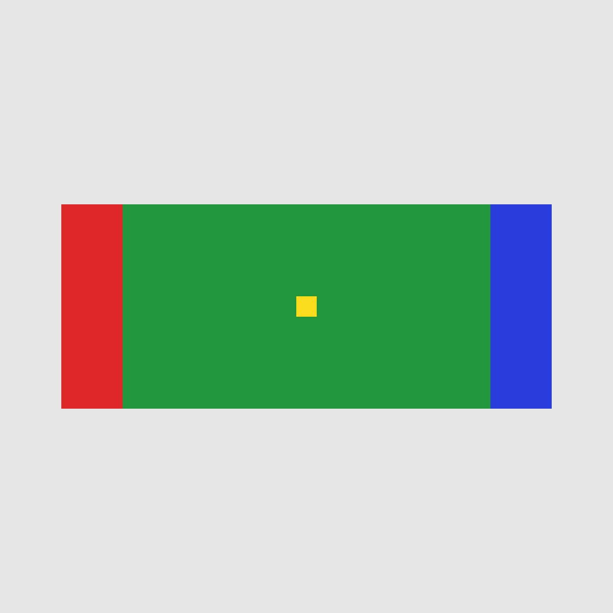
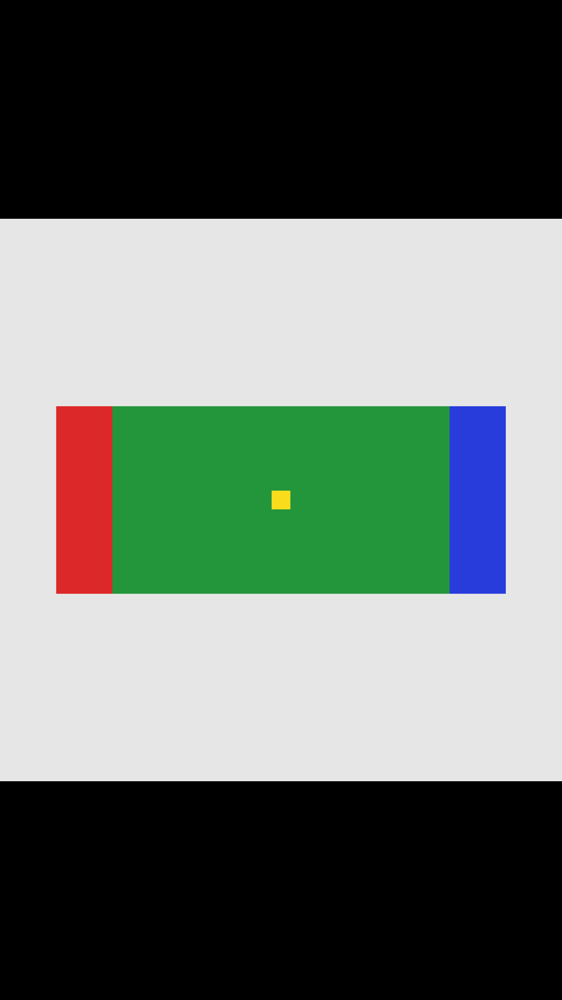

# Start-image framing lab

Prepare a square product image for a vertical video without discovering too late that the crop removed the handle, label or corners.

This repository is a small, reproducible framing exercise: an original calibration image, two real FFmpeg exports, a pixel-checking script, and a practical inspection worksheet. It teaches **what crop and padding do before image-to-video generation**. It does not generate a video or predict a model's output.

## See the decision

The source is a 1200 × 1200 square. Its red and blue end markers sit on a wide green rectangle. These shapes are synthetic calibration content, not a product photograph or an AI result.

| Source | Fit the whole square | Fill the vertical frame |
| --- | --- | --- |
|  |  |  |

Both exports are 720 × 1280. The fit keeps both coloured end markers; the centred crop removes both. Neither is a software error. They answer different composition requests.

For this exact geometry:

- Fit scales the square to 720 × 720 and adds 280 pixels above and below.
- Crop scales it to 1280 × 1280 and retains 720 pixels horizontally: 56.25% of the source width.
- In original-image coordinates, the centred crop retains x = 262.5 through 937.5. A subject spanning x = 120 through 1080 cannot fit inside it.

The source-coordinate interval describes continuous geometry. Resampling and integer pixel positions determine the exact boundary pixels in a rendered export. See [the method](FRAMING-METHOD.md) for the calculation and how to apply it to your own image.

## Reproduce the files and checks

Requirements: Python 3.10+, Pillow 12.3.0, and an FFmpeg build with MJPEG decoding, PNG encoding, `image2pipe` input, `image2` output, and the `scale`, `pad` and `crop` filters. No FFmpeg binary is bundled.

With [uv](https://docs.astral.sh/uv/guides/scripts/), run in an isolated temporary Python environment:

```sh
uv run --no-project --with Pillow==12.3.0 python framing_lab.py --out my-framing-run
```

Or use your own Python environment with Pillow installed:

```sh
python framing_lab.py --ffmpeg "/path/to/ffmpeg" --out my-framing-run
```

Choose a new output directory. The script refuses an existing directory and uses FFmpeg's no-overwrite option. It generates its own source image, runs both exports, opens the resulting files, checks their pixels and saves `result.json`. It does not read your product photos, upload data, or call imgmov.

The checked-in [result](examples/result.json) records the actual run and build. The six checks cover output dimensions, preservation/removal of coloured edge markers, and the presence/absence of black padding. A successful FFmpeg exit alone is not counted as a passing check.

## Use the method on a product image

1. Identify what must remain visible: handle, lid, base, packaging corners or readable label.
2. Mark the subject's bounding rectangle in the original image. Keep any empty source space separate from the product itself.
3. Compare the crop's retained region with that rectangle. If an important part falls outside it, try padding or another source composition.
4. Export and inspect the actual file beside the source. Confirm dimensions, proportions and required details.
5. Check the input rules of the service that will receive the file. Image format, file size and model restrictions are separate from composition.

For a browser workflow, [imgmov's start-image preparation utility](https://imgmov.com/resize-image-for-ai-video) offers crop and fit controls. Its local utility was tested on 1 November 2026 with a synthetic square: Crop, blurred fit and solid fit each exported 720 × 1280 JPEGs. This repository's automated test runs FFmpeg independently; it does not test that web service on every device.

Use the [delivery checklist](DELIVERY-CHECKLIST.md) and [copyable FFmpeg recipes](FFMPEG-RECIPES.md) to record what you actually checked. A ready input image is not a guarantee that generated footage will preserve the product's identity.

## Compare methods by the job

| Method | Retains | Gives up | Best inspection question |
| --- | --- | --- | --- |
| Centred crop | A region that fills the destination | Original edges | Did an essential part leave the frame? |
| Repositioned crop | Your chosen region | Different original edges | Is the whole required subject inside this region? |
| Fit with solid padding | The complete original picture | Full-frame coverage by the original | Is the subject now too small to inspect? |
| Fit with blurred padding | The complete original picture plus a blurred background treatment | A clean, uniform border | Does the enlarged background distract or resemble a duplicate item? |
| New portrait photograph | A composition made for the destination | Reuse of the old shot | Does this solve the camera-position problem more directly? |

Only centred crop and solid padding are automated in this lab. The other rows are editorial choices, not benchmark results. Padding is visible content; it may move or be interpreted as scenery by a video model. It is not generative expansion.

## Scope, related work and affiliation

Prepared by contributors working on imgmov, with AI assistance and reviewed against actual outputs. The linked imgmov utility is affiliated with this repository. FFmpeg and Pillow are independent projects; no endorsement is implied.

This is distinct from our [shot-planning and prompt templates](https://github.com/szj2ys/ai-video-prompt-templates) and [video frame-timing lab](https://github.com/szj2ys/video-frame-extraction-lab). Those address writing shot instructions and extracting an existing video's frames. This lab addresses **source-image geometry before generation**, with its own fixture and executable crop/padding checks.

The image/video generation backend is not part of this test or required by this lab. No generation-speed, sales, model-quality or ranking result is claimed. The test does not cover HDR, colour management, EXIF orientation, transparency, non-square pixels, HEIC, damaged files or every FFmpeg build. See [verification notes](VERIFICATION.md).

The [MIT license](LICENSE) covers this repository's newly authored text, script and synthetic fixtures. It does not change the licenses of external tools, websites or their documentation. Do not use customer photos or confidential media in public issues; reproduce a geometry problem with a synthetic example when possible.
